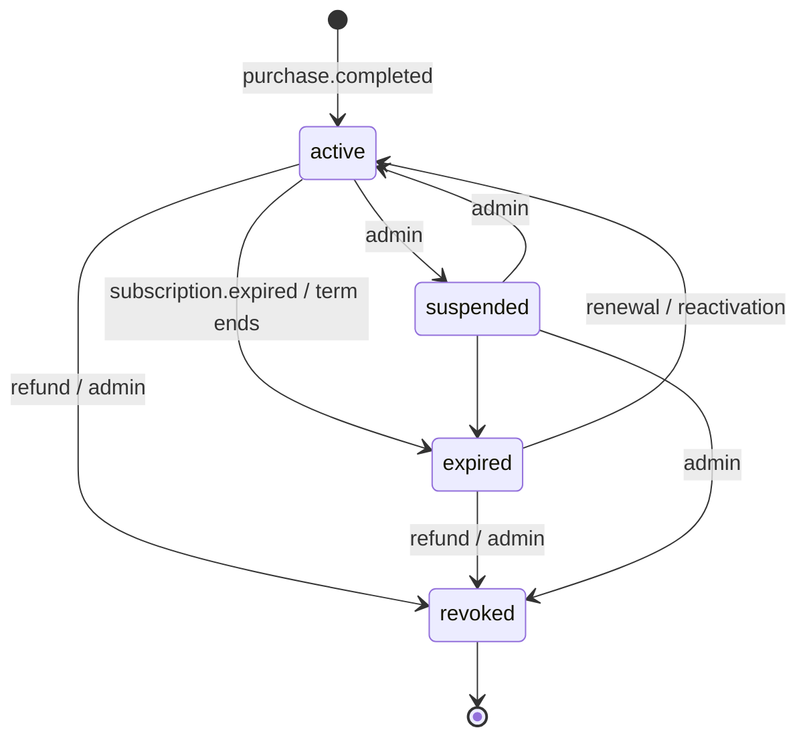
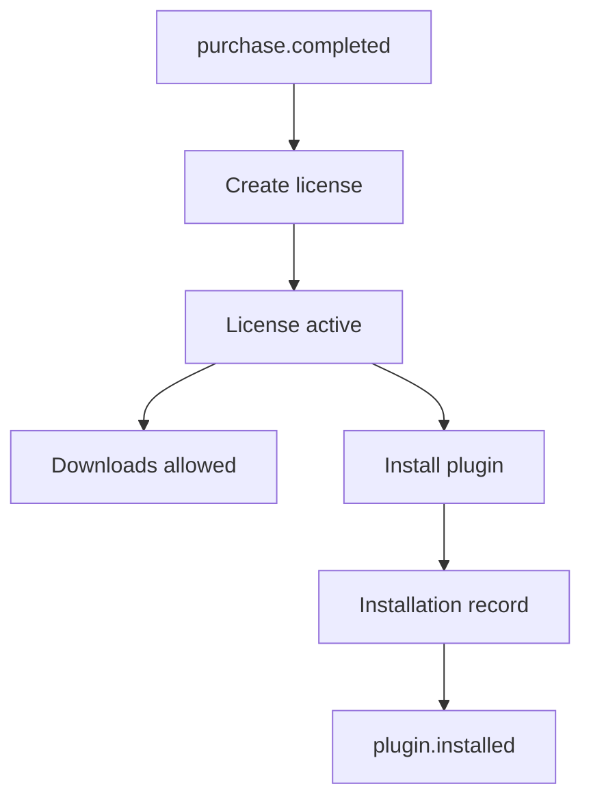
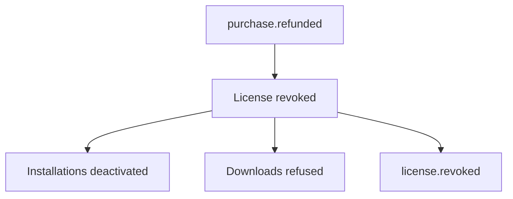
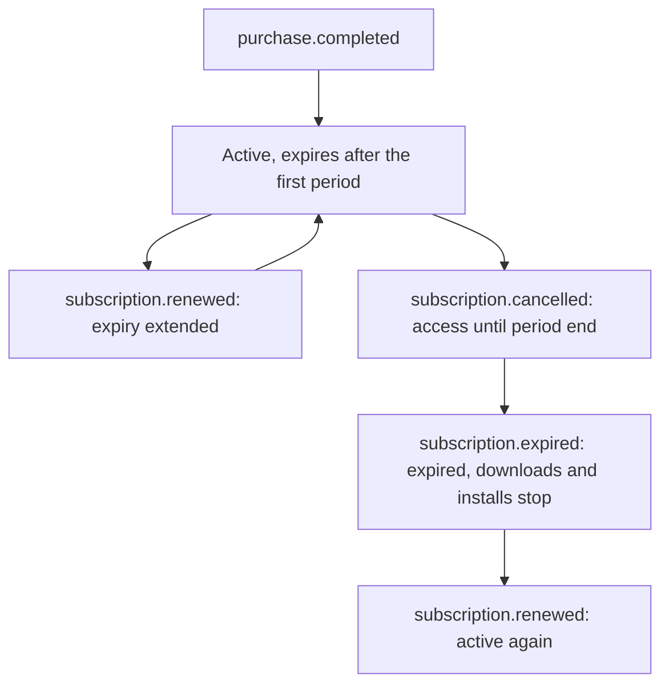

# Licensing module

**Contract version 1.0: CONTRACT FROZEN** (approved 19 October 2026). Public contracts are stable; breaking changes require version review, and implementations and adapters may now be built. Freeze checklist: [docs/architecture/licensing-contract-freeze-v1.md](../../../../docs/architecture/licensing-contract-freeze-v1.md). Specification: [docs/architecture/licensing-module-spec.md](../../../../docs/architecture/licensing-module-spec.md).

## Overview

One licensing engine for every digital product Meeovi sells: fonts, icons, photos, stock images, videos, music, templates, eBooks, Vibez assets, software, plugins, language packs, AI tools, courses and future product types. It's backend-agnostic: it consumes normalized commerce events and host interfaces, and never talks to Magento, Webkul, Shopify, WooCommerce, Saleor or Directus.

This folder holds the contracts (types, rules as pure functions) and `service.ts`, the licensing service built on them. It registers no routes, has no database, and doesn't authenticate anyone: the host supplies storage, identity and events (see "In this app").

It lives in `server/licensing/`, not `server/modules/`, on purpose. Nitro loads every folder in `server/modules/` as a Nitro module, which fails the build ("Cannot redefine property: setup").

| File | What it defines |
| --- | --- |
| `models.ts` | Entities, frozen values (scopes, permissions, statuses, target types), the status lifecycle, limit rules |
| `versioning.ts` | Terms versioning: parsing, major/minor rules, which version new purchasers get, immutability |
| `events.ts` | Commerce events (consumed) and webhook events (emitted), with payload schemas and validators |
| `interfaces.ts` | Services (frozen methods), host references and providers, the storage and idempotency ports, module wiring |
| `authorization.ts` | Who may do what (users, workspace admins, platform admins) |
| `errors.ts` | Error envelope, codes, status mapping, `LicensingError` |
| `api-contracts.ts` | REST endpoints with statuses, permissions, idempotency and error codes; request and response bodies |
| `service.ts` | `createLicensingModule(dependencies)`: the service, on the host's ports. Settles uniqueness races by re-reading after a unique violation |
| `tests/` | Contract and flow tests; in-memory storage in `tests/support/` (not exported) |

## Ownership boundaries

**Licensing owns:** licenses (purchased rights), installations, download records, license templates and their terms versions, and product license offers.

**Licensing does not own:** products, commerce, payments, checkout, subscriptions billing, users, identity, workspaces or file storage. Product, user, file and workspace ids are opaque references. Attaching an offer to a product doesn't transfer the product.

## Host references

The host provides these (`interfaces.ts`):

| Interface | Purpose |
| --- | --- |
| `AuthenticatedUserProvider` | The signed-in caller. One implementation per identity integration (Meeovi Auth, SSO, federated identity, future adapters); licensing only reads `AuthenticatedUser` |
| `ProductProvider`, `PurchaseProvider`, `SubscriptionProvider` | Normalized commerce data |
| `WorkspaceProvider` | Whether a user administers a workspace or organisation |
| `OutletProvider`, `IntegrationProvider` | Outlet access; whether an integration (plugin) exists |
| `LicenseRepository` | Storage, which must enforce the uniqueness rules below |
| `IdempotencyProvider` | Stores results per `Idempotency-Key` |
| `LicensingEventPublisher` | Delivers webhook events |

`LicensingModuleFactory(dependencies)` returns `forRequest({ user, idempotencyKey })`, which gives per-request services (so the frozen method signatures carry no caller or key), plus `commerceEvents` for the host's event feed.

## Lifecycle



`revoked` is final. Only an `active` license whose `expiresAt` hasn't passed grants downloads and installations (`grantsAccess`). There is no `partial_refund` status (see "Refund flows").

## Event flows

Commerce adapters normalize their own events into these five; anything else is rejected by `parseCommerceEvent`.

| Commerce event | Effect | Emits |
| --- | --- | --- |
| `purchase.completed` | Issue a UserLicense (`active`) under the newest active terms version; idempotent per purchase | `license.activated` |
| `purchase.refunded` | Revoke every license from that purchase, deactivate installations; downloads stop | `license.revoked` (reason `refund`) |
| `subscription.renewed` | Extend `expiresAt` (to the given period end, or by `expiresAfterDays`); reactivate if expired | `license.activated` when reactivated |
| `subscription.expired` | Mark `expired`, deactivate installations; downloads stop | `license.expired` |
| `subscription.cancelled` | No loss of access now: `expiresAt` set to the period end; `subscription.expired` follows | none |

Webhook events: `license.activated`, `license.revoked` (with `reason`), `license.expired`, `plugin.installed` and `plugin.removed` (with `pluginId`). Payloads are validated by `parseLicensingEvent` before publishing.



## Refund flows

**Immediate revocation** (plugins, language packs, digital assets, fonts, icons, templates): refund, then revoke the license, disable installations and disable downloads.



**Grace-period refunds** are a host policy (e.g. `refundGraceDays: 30`): the host decides whether a refund is allowed and, if so, emits `purchase.refunded`.

**Partial refunds** don't change rights: the license stays `active`, and no event is needed. For a bundle where one item loses its rights, the adapter emits `purchase.refunded` for that item's own purchase line (each line has its own `purchaseId`).

## Subscription flows



## Versioning

Terms are immutable: a change is a new `LicenseTypeVersion`, and `insertLicenseTypeVersion` must reject an existing id. Every UserLicense keeps the version it was issued under. Existing purchasers keep their rights, with no automatic migration, and new purchasers get the newest active version whose effective date has passed (`latestPurchasableVersion`).

- **Major** (`1.x` → `2.0`): any change to a permission flag, meaning commercial use, client projects, modification, redistribution, resale or attribution (`requiredChangeKind`).
- **Minor** (`1.0` → `1.1`): typos, formatting, clarifications, with identical rights.

## Authorization

| Who | May |
| --- | --- |
| Users | View, download, activate and renew their own licenses; install owned integrations on themselves, or on a workspace or organisation they administer; list their installations |
| Workspace administrators | Install into, list and remove installations on their workspace; view its licenses |
| Platform administrators (`admin` role) | Everything, including suspending, revoking, expiring and manually issuing licenses, and managing templates and versions |

No user gives `AUTH_REQUIRED` (401); a user without permission gives `LICENSE_ACCESS_DENIED` (403).

## Idempotency and uniqueness

Every state-changing request needs `Idempotency-Key` (missing: 400 `IDEMPOTENCY_KEY_REQUIRED`). A retry with the same key and the same request returns the stored result unchanged; the same key with a different request is 409 `DUPLICATE_IDEMPOTENCY_KEY`. Keys are scoped per user.

Storage must also enforce:
- one UserLicense per (`purchaseId`, `productLicenseId`), so a purchase event delivered twice issues one license;
- a unique `licenseKey`;
- one active installation per (`userLicenseId`, `targetType`, `targetId`) (409 `LICENSE_ALREADY_INSTALLED`).

## Errors

Every error is `{ "success": false, "error": { "code", "message", "details" } }`. Successes are `{ "success": true, "data" }`, except 204. Frozen codes: `LICENSE_NOT_FOUND` 404, `AUTH_REQUIRED` 401, `LICENSE_ACCESS_DENIED` 403, `INVALID_LICENSE_TYPE` 400, `INSTALL_LIMIT_EXCEEDED` 400, `LICENSE_ALREADY_INSTALLED` 409, `DUPLICATE_IDEMPOTENCY_KEY` 409. The other v1.0 codes and their statuses are in `errors.ts`; every status is from the approved set (200, 201, 202, 204; 400, 401, 403, 404, 409, 429; 500, 503).

## Implementation notes

- Create services per request with `forRequest`, resolving the user from the host's auth, and turn `LicensingError` into the envelope with `error.toResponse()` and `error.status`.
- Validate inbound commerce events with `parseCommerceEvent`, and outbound webhooks with `parseLicensingEvent`.
- Limits: an omitted `maxDownloads` or `maxInstallations` means unlimited, and `0` means none. Only active installations count.
- `plugin.*` events carry `pluginId`, taken from the offer's `metadata.pluginId` and falling back to the product id.
- Downloads are an append-only audit log. Store what the host's audit policy needs in `metadata`.
- Storage implementations must pass the flow tests: run them with `LICENSING_TEST_DATABASE_URL` (see "Verification").
- Not in v1.0: license transfer, and "view version history" beyond `listLicenseTypeVersions`. Both are additive, for v1.1.

## In this app

| Piece | Where |
| --- | --- |
| Database | `licensing` schema in the app's Postgres, created by `layers/auth/server/database/migrations/20261019120000_licensing_schema` (applied 19 October 2026). Unique constraints, immutable terms and append-only downloads are enforced in the database. Hidden from Directus and Supabase's API roles |
| Storage and idempotency | `layers/commerce/server/licensing-host/postgres.ts` (`PostgresLicenseRepository`, `PostgresIdempotency`) |
| Wiring | `licensing-host/index.ts`: `useLicensing()`, `licensingFor(event)` (better-auth user, `Idempotency-Key` header), the response envelope, default integration offers. A user's workspace id is their user id; better-auth organisation owners and admins manage their organisation. Webhook events go to the Nitro hook `licensing:event` |
| REST | `layers/commerce/server/api/licenses/…` and `api/installations/[id].delete.ts`, exactly the frozen endpoints |
| Commerce events | `licensing-host/commerce-events.ts`, called by the Stripe webhook: a paid checkout issues a license per paid integration line (`purchase.completed`, purchase id `stripe:<payment intent>`); a full refund (`charge.refunded`) revokes them (`purchase.refunded`) |
| Offers | Seeded license types Personal, Commercial and Workspace (terms v1.0). Each paid integration gets a default Personal offer (`default:<product key>`) at the store price, created on first sale |
| Integrations | `layers/commerce/server/plugins/licensing-entitlements.ts` registers licensing as meeovi-integrations' entitlement source: paid integrations are on while the user holds an active license; switching one on or off records a licensing installation on their account |

Licenses issued before this existed: the 17 October Habit Tracker test purchase (qaadmin) was backfilled under its Stripe payment intent.

## Verification

From `layers/commerce`:

```sh
npx vitest run --config server/licensing/vitest.config.ts
```

The flow tests run in memory by default. To run them on the Postgres storage, start a throwaway database with the migration applied and point `LICENSING_TEST_DATABASE_URL` at it; every licensing table there is emptied before each test:

```sh
docker run -d --rm --name licensing-test-pg -e POSTGRES_PASSWORD=… -p 127.0.0.1:55432:5432 postgres:14
docker exec -i licensing-test-pg psql -U postgres < ../auth/server/database/migrations/20261019120000_licensing_schema/migration.sql
LICENSING_TEST_DATABASE_URL=postgres://postgres:…@127.0.0.1:55432/postgres npx vitest run --config server/licensing/vitest.config.ts
```
