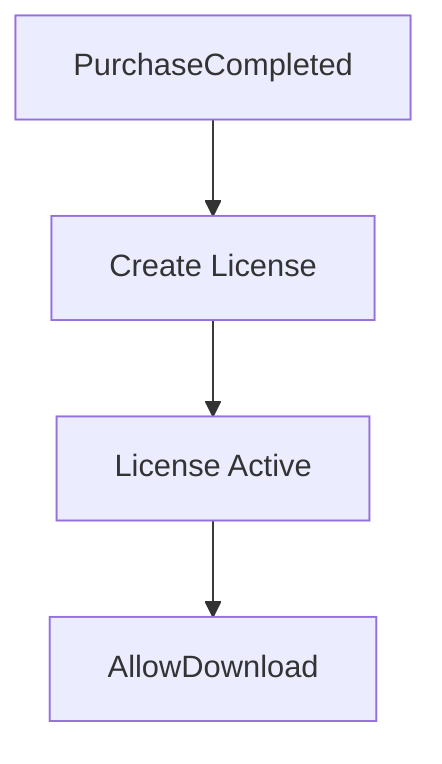
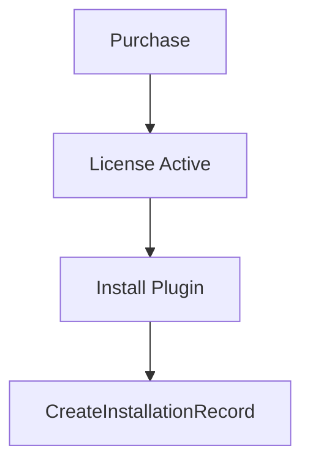
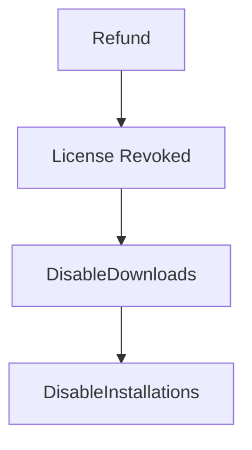
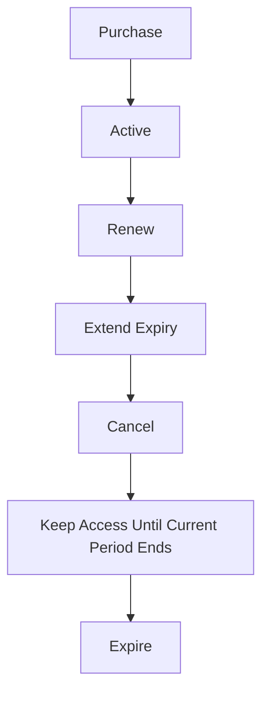

# Licensing Module

This directory defines the backend-agnostic licensing domain and its integration contracts. It has no database, HTTP handler, authentication implementation, or commerce-adapter dependency. Host applications provide implementations of the interfaces exported from `interfaces.ts`.

## Boundaries

### Licensing Owns

- Licenses and their purchased rights
- Installations
- Download records
- License terms and versions

### Licensing Does Not Own

- Products
- Commerce
- Payments
- Checkout
- Users

Product IDs and user IDs are references supplied by host interfaces. A product-license association does not transfer ownership of the product to this module.

- `models.ts` defines license templates, immutable terms versions, product offers, user rights, installations, and download records.
- `interfaces.ts` defines licensing services and the ports used to reach products, purchases, subscriptions, authenticated users, workspaces, outlets, integrations, persistence, idempotency, and event delivery.
- `events.ts` defines normalized commerce events and licensing webhook event names.
- `api-contracts.ts` describes the REST surface, authentication and idempotency requirements, response envelopes, and error status mapping. It does not register routes.

Product types are intentionally open-ended: product identity is represented by an opaque ID and optional metadata rather than a product-category enum. Existing or future adapters can normalize their events into `CommerceEvent` without introducing adapter-specific code here.

All state-changing API operations require the `Idempotency-Key` header. The provider contract must return the original result for a retried key and prevent duplicate license issuance, installation, or download recording. License terms versions are readonly contracts; issued user licenses retain their version ID so later terms changes do not rewrite purchased rights.

The module consumes an `AuthenticatedUser` supplied by the host auth integration. It does not authenticate users. Workspace, outlet, and integration access are exposed as provider interfaces, not direct dependencies.

## Lifecycle Diagrams

### Digital Asset Purchase



### Plugin Installation



### Refund



### Subscription



## Verification

Run the isolated API contract tests from the commerce layer with:

```sh
npx vitest run --config server/modules/licensing/vitest.config.ts
```